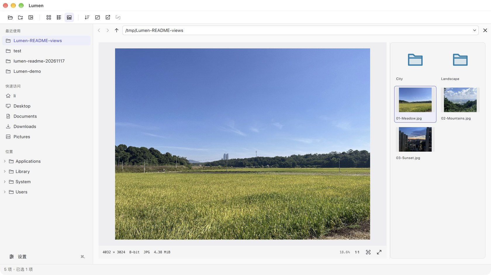
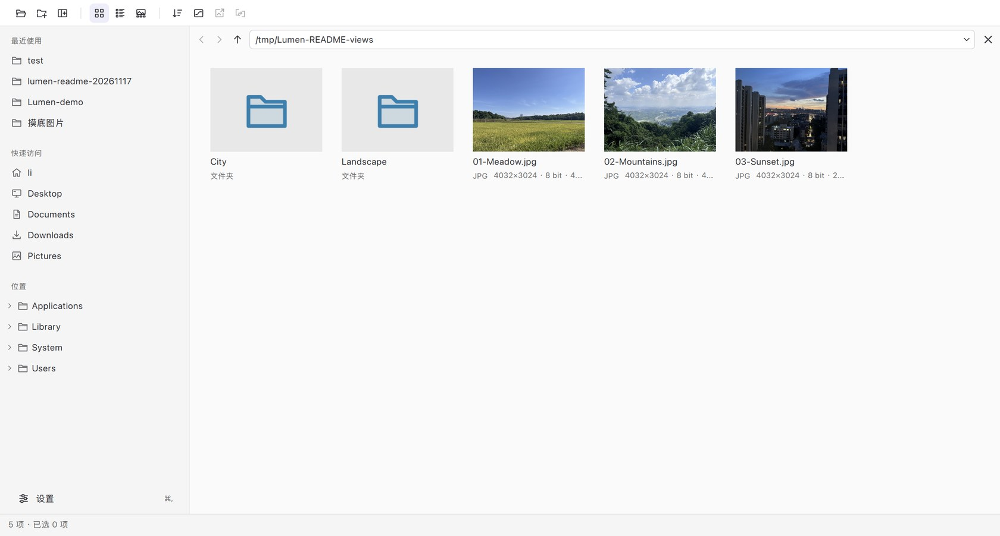
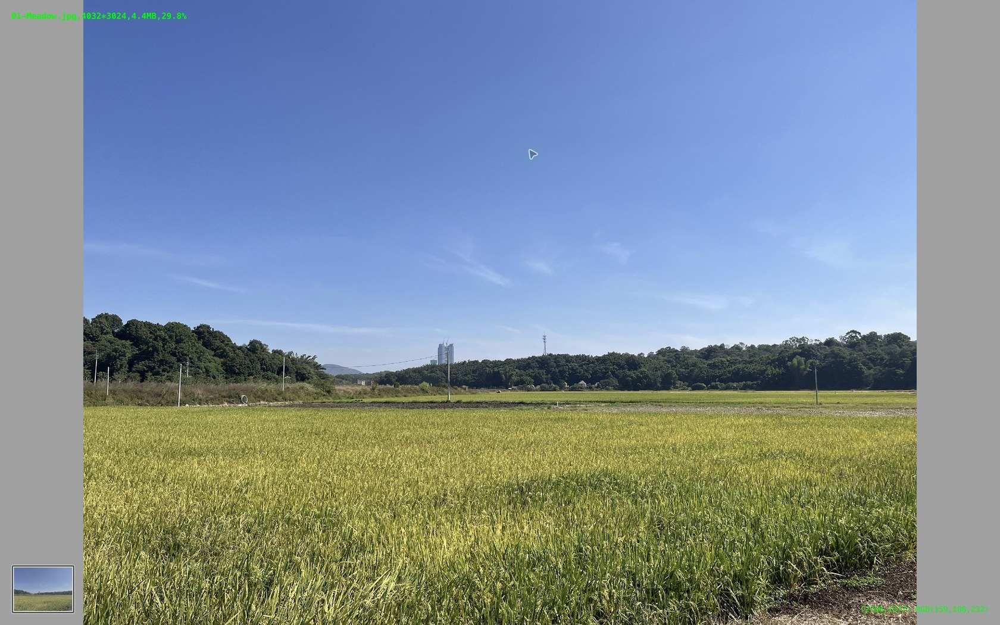
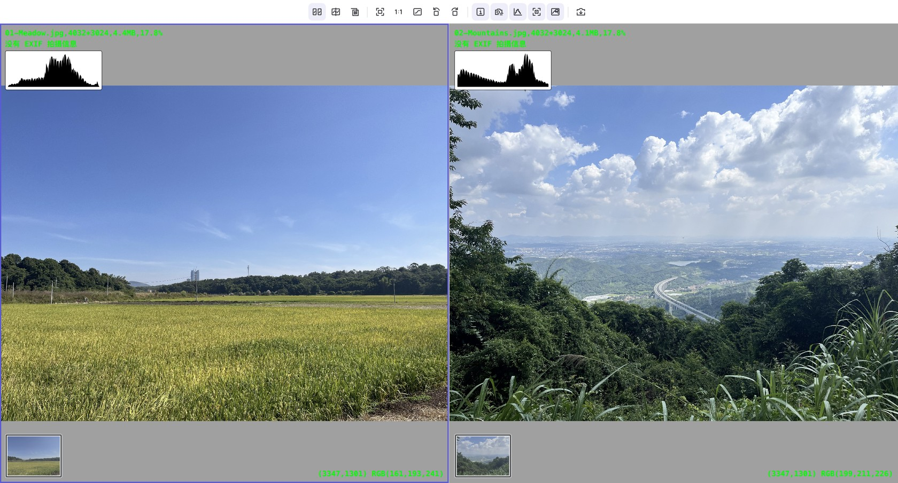
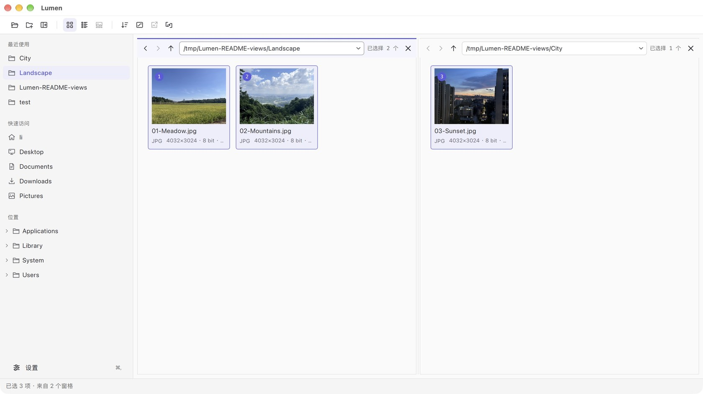
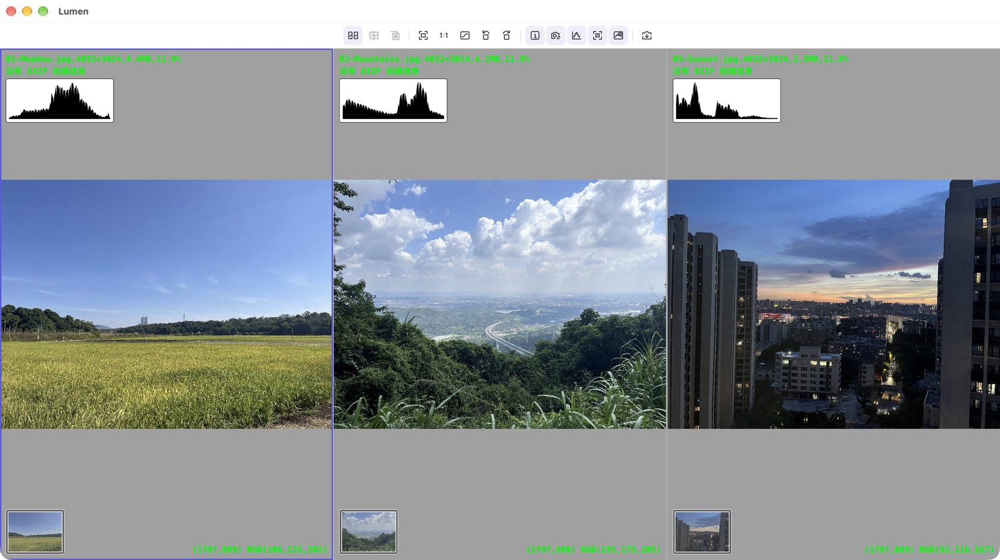

<p align="center">
  
</p>

<h1 align="center">Lumen</h1>

<p align="center">
  <a href="https://github.com/L1xiaolong/Lumen/releases"></a>
  <a href="https://github.com/L1xiaolong/Lumen/releases"></a>
  <a href="#环境依赖"></a>
  <a href="CMakeLists.txt"></a>
  <a href="CMakeLists.txt"></a>
  <a href="https://github.com/L1xiaolong/Lumen/actions/workflows/release.yml"></a>
</p>

<p align="center"><strong>轻快看图，细看像素，同步比较</strong></p>
<p align="center">轻量化超快的跨平台专业桌面图片查看及对比工具，满足专业图像调试对比需求</p>
<p align="center">简体中文 · <a href="README_EN.md">English</a></p>
<p align="center">
  <a href="https://github.com/L1xiaolong/Lumen/releases">下载安装</a> ·
  <a href="#特色">特色</a> ·
  <a href="#环境依赖">环境依赖</a> ·
  <a href="#构建方法">构建方法</a> ·
  <a href="#分发与许可证">分发与许可证</a>
</p>




## 特色

- **YUV / DNG/ 无头RAW 支持**：无需先转换成普通图片，支持相机 RAW、Bayer RAW10/12/16，以及 NV12 / NV21 / I420 / P010。
- **跨文件夹比较**：支持同时打开2～4个目录，一键同步对比，无需来回切换或复制文件。
- **快速解析，流畅观看**：异步解码、分级预览与缩略图缓存，浏览、切图、查看大图更顺畅。
- **轻量化，专注看图**：围绕浏览、选片和比较展开，常用操作触手可及；支持联动缩放、平移、滑动分割与A/B比较。
- **现代、简洁的界面**：网格、画廊与全屏看图自由切换，支持亮暗主题和中英文界面。
- **像素细节随时可查**：RGB / RAW / YUV 像素读数、元数据、直方图与 ROI 区域统计，可选 ICC 色彩管理。


## 界面一览

### 主界面 · 网格视图

目录与缩略图一目了然，快速浏览和选择图片。



### 全屏看图

专注画面本身，同时查看文件信息与像素读数。



### 图片对比

并排查看图片，同步缩放和平移，结合直方图与像素值观察差异。



### 跨文件夹比较

从不同文件夹选图，保留各窗格的选择，再统一进入对比。






## 下载与运行

**前往 [GitHub Releases](https://github.com/L1xiaolong/Lumen/releases)，展开对应版本的 Assets，选择安装包。**

| 平台 | 下载文件 | 安装方式 |
| --- | --- | --- |
| macOS · Apple Silicon（arm64） | `Lumen-…-macos-arm64.dmg` | 打开 DMG，将 Lumen 拖入 Applications |
| Windows · x64 | `Lumen-…-windows-x64-setup.exe` | 运行安装器，按向导完成安装 |

发布包包含部署后的运行依赖，无需另外安装 Qt 或编译工具。GitHub 自动生成的 `Source code` 压缩包用于源码构建。

打开应用后选择图片文件夹，选中 2～4 张图片即可进入对比。也可通过命令行打开目录：

```sh
# macOS
open -a Lumen --args /path/to/images
```

```powershell
# Windows：在安装目录执行，或先将其加入 PATH
.\Lumen.exe "D:\Photos"
```

## 环境依赖

以下依赖仅用于**源码构建**。仓库提供 macOS arm64 和 Windows x64 的构建预设及发布流程。CI 在发布前执行两平台构建与 QML 静态检查。

| 依赖 | 要求 / 用途 |
| --- | --- |
| 编译工具 | CMake 3.25+、C++20 编译器；macOS 使用 Xcode Command Line Tools，Windows 推荐 MSYS2/UCRT64 |
| Qt | 6.9+；Core、Gui、Network、Quick、QuickControls2、QuickLayouts、QuickTemplates2、Svg、ShaderTools、LinguistTools，及**同版本 Gui 私有开发头文件** |
| LibRaw / Exiv2 | LibRaw 0.21+、Exiv2 0.28+；用于相机 RAW 解码与元数据读取 |
| LittleCMS | 可选，2.x；提供 ICC 色彩管理，未找到时自动禁用 |
| 打包工具 | Python 3.9+；macOS 需要 `macdeployqt` 及系统签名、DMG 工具，Windows 需要 `windeployqt` 和 NSIS |

## 构建方法

先获取源码，以下命令均在仓库根目录执行：

```sh
git clone https://github.com/L1xiaolong/Lumen.git
cd Lumen
```

### macOS · Apple Silicon

安装 Homebrew 与 Xcode Command Line Tools 后：

```sh
brew install cmake qt libraw exiv2 little-cms2 pkgconf
./build_macos.sh release

# 生成包含运行依赖的 DMG 与 ZIP，输出到 dist/
./build_macos.sh package
```

应用生成于 `build/macos-preset-release/src/qml/Lumen.app`。自定义 Qt 路径、签名与打包选项见 `./build_macos.sh --help`。


直接使用 CMake / Crashpad 配置

```sh
cmake --preset macos-release \
  -DCMAKE_PREFIX_PATH="$(brew --prefix)" \
  -DMVPVIEW_ENABLE_CRASHPAD=OFF
cmake --build --preset macos-release --parallel
```

当前 macOS 构建脚本默认关闭 Crashpad。直接使用 CMake 时默认启用，首次构建需要网络、Git 和 Xcode 工具链，以构建固定版本的 Crashpad。关闭后崩溃采集不可用，日志和诊断导出仍可使用。


### Windows · MSYS2/UCRT64

在 **MSYS2 UCRT64 终端**安装依赖：

```sh
pacman -S --needed \
  mingw-w64-ucrt-x86_64-toolchain \
  mingw-w64-ucrt-x86_64-cmake mingw-w64-ucrt-x86_64-ninja \
  mingw-w64-ucrt-x86_64-pkgconf \
  mingw-w64-ucrt-x86_64-qt6-base mingw-w64-ucrt-x86_64-qt6-declarative \
  mingw-w64-ucrt-x86_64-qt6-svg mingw-w64-ucrt-x86_64-qt6-shadertools \
  mingw-w64-ucrt-x86_64-qt6-tools \
  mingw-w64-ucrt-x86_64-libraw mingw-w64-ucrt-x86_64-exiv2 \
  mingw-w64-ucrt-x86_64-lcms2 mingw-w64-ucrt-x86_64-python \
  mingw-w64-ucrt-x86_64-nsis
```

随后在 PowerShell 中执行：

```powershell
$env:MSYS2_UCRT64 = "C:/msys64/ucrt64"
.\build_windows.ps1 -Toolchain msys2 -Mode release

# 生成安装器与 ZIP，输出到 dist/
.\build_windows.ps1 -Toolchain msys2 -Mode package
```

直接使用 CMake / MSVC 构建

在 UCRT64 终端中可直接编译：

```sh
export MSYS2_UCRT64="C:/msys64/ucrt64"
cmake --preset windows-msys2-release
cmake --build --preset windows-msys2-release --parallel
```

脚本也支持 `-Toolchain msvc`（Visual Studio 2022 x64）。需准备匹配编译器的 Qt SDK，并配置 vcpkg 工具链；图像库依赖见 [vcpkg.json](vcpkg.json)，ICC 支持对应 `color-management` feature。更多参数见 `.\build_windows.ps1 -Help`。


## 分发与许可证

**原创代码采用 MIT；包含第三方依赖的完整安装包须同时遵守这些依赖的许可证。**

- **项目代码与原创资源**：采用 [MIT 许可证](LICENSE)，允许使用、修改和再分发，须保留版权及许可声明。
- **第三方组件**：Qt、LibRaw、Exiv2、LittleCMS、miniz 及可选 Crashpad 等保留各自许可证，详见 [第三方声明](THIRD_PARTY_NOTICES.md)。其中 [Exiv2 使用 GPL-2.0-or-later](https://exiv2.org/download.html)，分发链接它的完整应用时需满足相应 GPL 许可与源码交付要求，不能仅凭本仓库的 MIT 声明判断整个安装包的分发条件。
