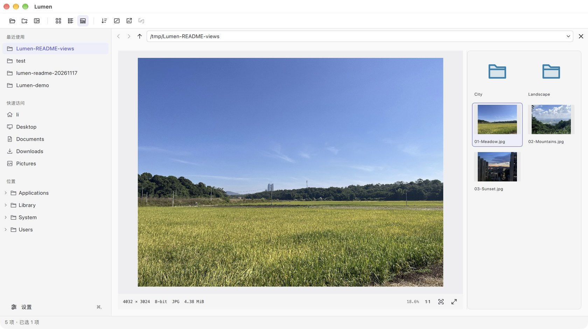
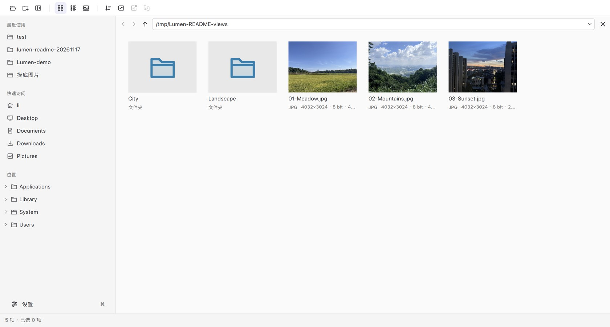
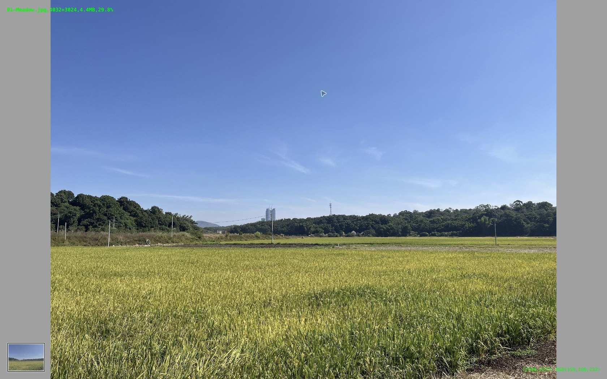
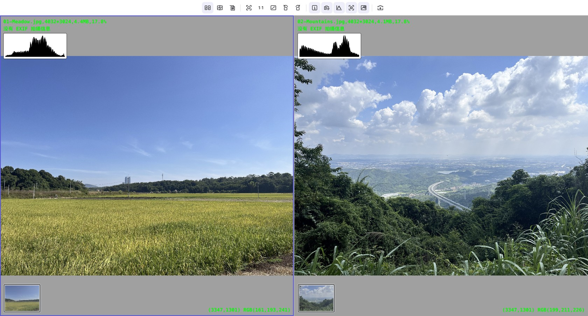
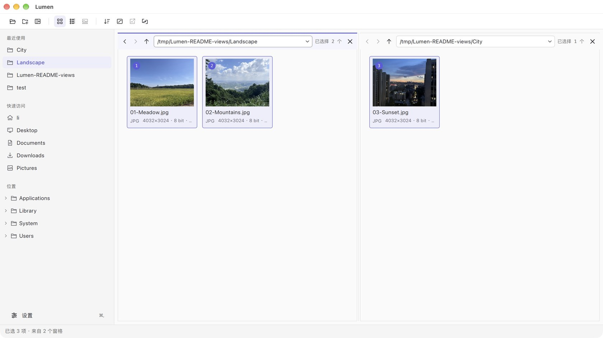
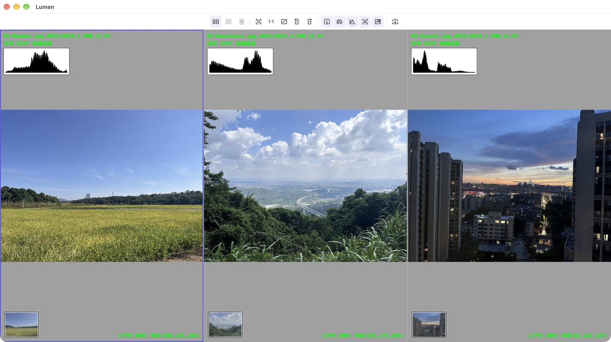

<p align="center">
  
</p>

<h1 align="center">Lumen</h1>

<p align="center">
  <a href="https://github.com/L1xiaolong/Lumen/releases"></a>
  <a href="https://github.com/L1xiaolong/Lumen/releases"></a>
  <a href="#build-requirements"></a>
  <a href="CMakeLists.txt"></a>
  <a href="CMakeLists.txt"></a>
  <a href="https://github.com/L1xiaolong/Lumen/actions/workflows/release.yml"></a>
</p>

<p align="center"><strong>Browse fast. Inspect pixels. Compare in sync.</strong></p>
<p align="center">A lightweight, ultra-fast and cross-platform desktop image viewer and comparison tool for professional image inspection and debugging.</p>
<p align="center"><a href="README.md">简体中文</a> · English</p>
<p align="center">
  <a href="https://github.com/L1xiaolong/Lumen/releases">Download</a> ·
  <a href="#features">Features</a> ·
  <a href="#build-requirements">Build requirements</a> ·
  <a href="#building-from-source">Building from source</a> ·
  <a href="#distribution-and-licensing">Distribution and licensing</a>
</p>



## Features

- **YUV / DNG / headerless RAW support**: Open images without converting them first. Supports camera RAW, Bayer RAW10/12/16, and NV12 / NV21 / I420 / P010.
- **Cross-folder comparison**: Open 2–4 folders at once and start synchronized comparison with one click, without switching back and forth or copying files.
- **Fast decoding, smooth viewing**: Asynchronous decoding, staged previews, and thumbnail caching keep browsing, switching images, and viewing large images responsive.
- **Lightweight and focused**: Built around browsing, selecting, and comparing images, with common actions close at hand. Supports synchronized zoom and pan, sliding splits, and A/B comparison.
- **A modern, clean interface**: Switch freely between grid, gallery, and full-screen views, with light and dark themes and Chinese and English interfaces.
- **Pixel details at your fingertips**: RGB / RAW / YUV pixel values, metadata, histograms, ROI statistics, and optional ICC color management.

## Interface overview

### Main window · Grid view

Browse folders and thumbnails at a glance to find and select images quickly.



### Full-screen viewing

Focus on the image while keeping file information and pixel values available.



### Image comparison

View images side by side with synchronized zoom and pan, using histograms and pixel values to inspect differences.



### Cross-folder comparison

Select images from different folders, retain each pane's selection, and compare them together.





## Download and run

**Visit [GitHub Releases](https://github.com/L1xiaolong/Lumen/releases), expand Assets for your chosen version, and download the installer.**

| Platform | Download | Installation |
| --- | --- | --- |
| macOS · Apple Silicon (arm64) | `Lumen-…-macos-arm64.dmg` | Open the DMG and drag Lumen into Applications |
| Windows · x64 | `Lumen-…-windows-x64-setup.exe` | Run the installer and follow the setup wizard |

Release packages include the required runtime dependencies. There is no need to install Qt or build tools separately. GitHub's automatically generated `Source code` archives are intended for building from source.

Open the app, choose an image folder, and select 2–4 images to compare. You can also open a folder from the command line:

```sh
# macOS
open -a Lumen --args /path/to/images
```

```powershell
# Windows: run from the installation directory, or add it to PATH first
.\Lumen.exe "D:\Photos"
```

## Build requirements

These dependencies are needed only when **building from source**. The repository provides build presets and release workflows for macOS arm64 and Windows x64. CI runs builds and QML static analysis on both platforms before release.

| Dependency | Requirements / purpose |
| --- | --- |
| Build tools | CMake 3.25+ and a C++20 compiler; Xcode Command Line Tools on macOS, MSYS2/UCRT64 recommended on Windows |
| Qt | 6.9+; Core, Gui, Network, Quick, QuickControls2, QuickLayouts, QuickTemplates2, Svg, ShaderTools, LinguistTools, and **Gui private development headers matching the Qt version** |
| LibRaw / Exiv2 | LibRaw 0.21+ and Exiv2 0.28+ for camera RAW decoding and metadata reading |
| LittleCMS | Optional, 2.x; enables ICC color management and is automatically disabled if unavailable |
| Packaging tools | Python 3.9+; `macdeployqt` and system signing/DMG tools on macOS, `windeployqt` and NSIS on Windows |

## Building from source

Clone the repository first. Run all subsequent commands from its root directory:

```sh
git clone https://github.com/L1xiaolong/Lumen.git
cd Lumen
```

### macOS · Apple Silicon

After installing Homebrew and Xcode Command Line Tools:

```sh
brew install cmake qt libraw exiv2 little-cms2 pkgconf
./build_macos.sh release

# Create a DMG and ZIP with runtime dependencies in dist/
./build_macos.sh package
```

The app is generated at `build/macos-preset-release/src/qml/Lumen.app`. See `./build_macos.sh --help` for custom Qt paths, signing, and packaging options.

Using CMake directly / configuring Crashpad

```sh
cmake --preset macos-release \
  -DCMAKE_PREFIX_PATH="$(brew --prefix)" \
  -DMVPVIEW_ENABLE_CRASHPAD=OFF
cmake --build --preset macos-release --parallel
```

The current macOS build script disables Crashpad by default. When using CMake directly, Crashpad is enabled by default, and the first build requires network access, Git, and the Xcode toolchain to build a pinned version of Crashpad. Disabling it makes crash capture unavailable; logging and diagnostic export remain available.

### Windows · MSYS2/UCRT64

Install dependencies in the **MSYS2 UCRT64 terminal**:

```sh
pacman -S --needed \
  mingw-w64-ucrt-x86_64-toolchain \
  mingw-w64-ucrt-x86_64-cmake mingw-w64-ucrt-x86_64-ninja \
  mingw-w64-ucrt-x86_64-pkgconf \
  mingw-w64-ucrt-x86_64-qt6-base mingw-w64-ucrt-x86_64-qt6-declarative \
  mingw-w64-ucrt-x86_64-qt6-svg mingw-w64-ucrt-x86_64-qt6-shadertools \
  mingw-w64-ucrt-x86_64-qt6-tools \
  mingw-w64-ucrt-x86_64-libraw mingw-w64-ucrt-x86_64-exiv2 \
  mingw-w64-ucrt-x86_64-lcms2 mingw-w64-ucrt-x86_64-python \
  mingw-w64-ucrt-x86_64-nsis
```

Then run in PowerShell:

```powershell
$env:MSYS2_UCRT64 = "C:/msys64/ucrt64"
.\build_windows.ps1 -Toolchain msys2 -Mode release

# Create an installer and ZIP in dist/
.\build_windows.ps1 -Toolchain msys2 -Mode package
```

Using CMake directly / building with MSVC

You can build directly in the UCRT64 terminal:

```sh
export MSYS2_UCRT64="C:/msys64/ucrt64"
cmake --preset windows-msys2-release
cmake --build --preset windows-msys2-release --parallel
```

The script also supports `-Toolchain msvc` (Visual Studio 2022 x64). Prepare a Qt SDK matching your compiler and configure the vcpkg toolchain. See [vcpkg.json](vcpkg.json) for image library dependencies; ICC support uses the `color-management` feature. For more options, run `.\build_windows.ps1 -Help`.

## Distribution and licensing

**Original code is licensed under MIT. Complete installers containing third-party dependencies must also comply with those dependencies' licenses.**

- **Project code and original assets**: Licensed under the [MIT License](LICENSE), allowing use, modification, and redistribution, provided that copyright and license notices are retained.
- **Third-party components**: Qt, LibRaw, Exiv2, LittleCMS, miniz, and optional Crashpad components retain their respective licenses. See [Third-party notices](THIRD_PARTY_NOTICES.md). In particular, [Exiv2 is licensed under GPL-2.0-or-later](https://exiv2.org/download.html). Distributing a complete application linked against it requires compliance with the applicable GPL licensing and source delivery requirements. The repository's MIT notice alone does not determine the distribution terms of the entire installer.
